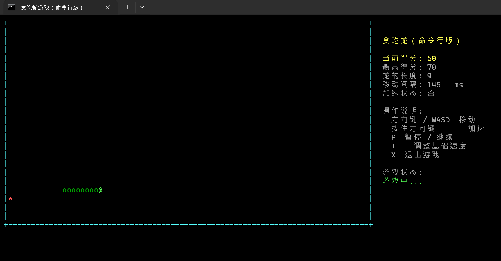
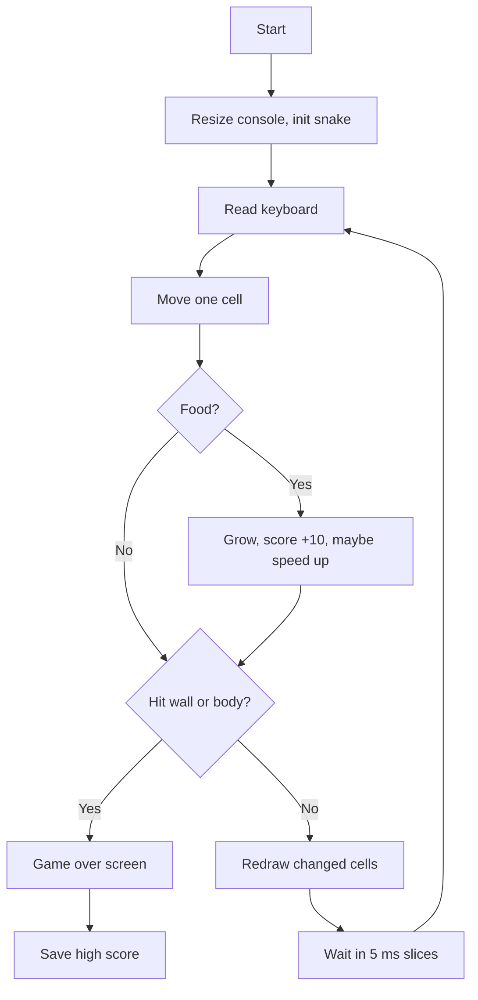

# Snake (Command-Line Version)

English | [简体中文](README.zh-CN.md)

A small Snake game for the Windows console, written in C.


## Introduction



This is a console version of Snake for Windows. The board is 80 × 22 cells, and the panel on the right keeps the score, snake length, moving interval and boost state in view while you play.

You steer with the arrow keys or WASD. Holding a direction key moves the snake at 2× speed, `+` and `-` change the base speed, and the best score is written to `snake_highscore.txt` when the round ends. Hitting a wall or your own body ends the round; filling the whole board counts as a win.

The whole game is one C file with no third-party libraries. The only platform dependency is the Win32 console API, used for window sizing, colors and cursor control.



## Dependencies

- C99 compiler: MinGW-w64 GCC or MSVC
- Windows 10 / 11, for the console API
- No third-party libraries

## Project Structure

```text
.
├── 贪吃蛇（命令行版）.c   # game source
├── snake_highscore.txt    # saved high score
├── README.md              # English documentation
├── README.zh-CN.md        # Chinese documentation
├── LICENSE
└── .gitignore
```

## Usage

### Build

MinGW:

```bash
gcc "贪吃蛇（命令行版）.c" -O2 -o snake.exe
```

MSVC:

```bash
cl /O2 /utf-8 "贪吃蛇（命令行版）.c" /Fe:snake.exe
```

### Run

```bash
snake.exe
```

Start it from the project folder so the high score file is created next to the source.

### Controls

| Key | Action |
| --- | --- |
| Arrow keys / WASD | Steer the snake |
| Hold a direction key | Temporary 2× speed |
| `P` | Pause / resume |
| `+` or `=` | Increase base speed |
| `-` or `_` | Decrease base speed |
| `X` | Quit |

### Notes

- The source is saved as UTF-8, and the game switches the console code page itself.
- The window is resized on startup; if the console does not allow it, the game falls back to the `mode con` command.
- Each frame only redraws the cells that changed, so the display stays stable at higher speeds.

## Contributing

Bug reports and pull requests are welcome. Please keep the single-file layout and the existing comment style. Before opening a pull request, build once with warnings enabled:

```bash
gcc "贪吃蛇（命令行版）.c" -O2 -Wall -Wextra -o snake.exe
```

## Contact

**Dr. Ailan Anjuxi (谙弆悕)**

- 📫 Email: `anjuxi.ME@outlook.com`
- 📞 SIP: `sip:anjuxi@sip.linphone.org`
