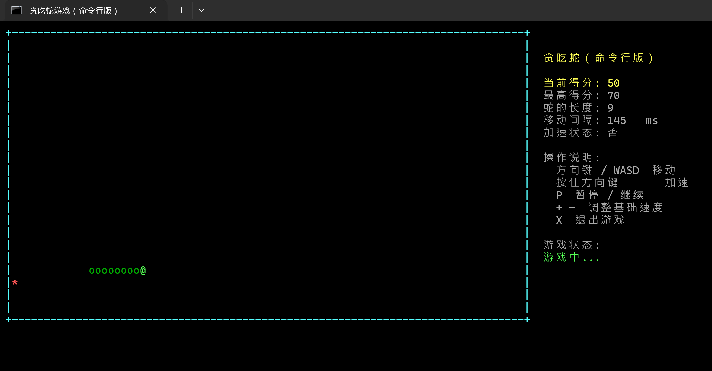
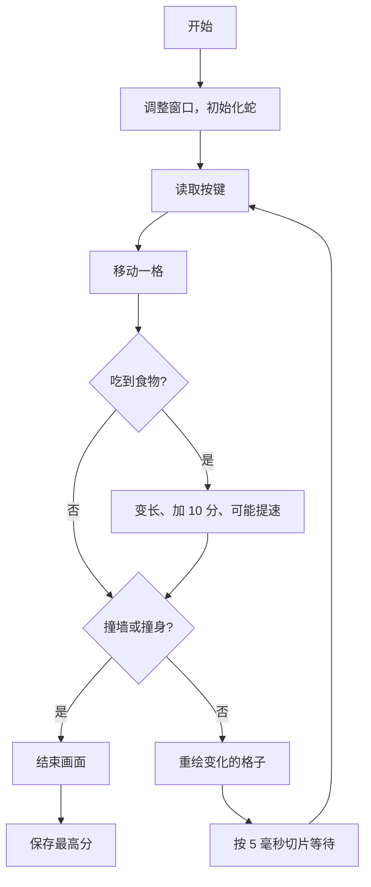

# 贪吃蛇（命令行版）

[English](README.md) | 简体中文

用 C 写的 Windows 控制台贪吃蛇。


## 项目介绍



这是跑在 Windows 控制台里的贪吃蛇。棋盘 80 × 22 格，右侧一栏实时显示分数、蛇长、移动间隔和加速状态。

用方向键或 WASD 控制方向，长按方向键临时两倍速，`+` / `-` 调整基础速度。一局结束时最高分会写进 `snake_highscore.txt`。撞墙或撞到自己就结束，把棋盘填满算通关。

整个游戏只有一个 C 文件，没有第三方依赖。平台相关的部分只有 Win32 控制台 API，用来调窗口大小、设置颜色和控制光标。



## 依赖说明

- C99 编译器：MinGW-w64 GCC 或 MSVC
- Windows 10 / 11，用于控制台 API
- 无第三方库

## 项目结构

```text
.
├── 贪吃蛇（命令行版）.c   # 游戏源码
├── snake_highscore.txt    # 最高分存档
├── README.md              # 英文文档
├── README.zh-CN.md        # 中文文档
├── LICENSE
└── .gitignore
```

## 使用说明

### 编译

MinGW：

```bash
gcc "贪吃蛇（命令行版）.c" -O2 -o snake.exe
```

MSVC：

```bash
cl /O2 /utf-8 "贪吃蛇（命令行版）.c" /Fe:snake.exe
```

### 运行

```bash
snake.exe
```

建议在项目目录下启动，这样最高分会存在源码旁边。

### 操作

| 按键 | 功能 |
| --- | --- |
| 方向键 / WASD | 控制蛇的方向 |
| 长按方向键 | 临时两倍速 |
| `P` | 暂停 / 继续 |
| `+` 或 `=` | 提高基础速度 |
| `-` 或 `_` | 降低基础速度 |
| `X` | 退出游戏 |

### 备注

- 源码是 UTF-8 编码，程序启动时会自己切换控制台代码页。
- 启动时会调整窗口大小；如果控制台不允许，会退回 `mode con` 命令。
- 每帧只重绘变化的格子，速度提上去以后画面也不会闪。

## 贡献指南

欢迎提 Issue 和 PR。请保持单文件结构和现有的注释风格。提交 PR 前先开警告编译一遍：

```bash
gcc "贪吃蛇（命令行版）.c" -O2 -Wall -Wextra -o snake.exe
```

## 联系作者

**谙弆悕博士（Ailan Anjuxi）**

- 📫 邮箱：`anjuxi.ME@outlook.com`
- 📞 SIP 电话：`sip:anjuxi@sip.linphone.org`

